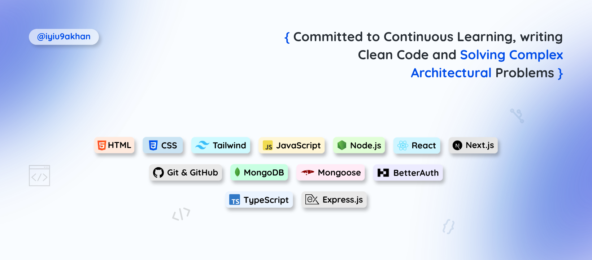

  

<h1 align="center">Muhammad Sameer Khan</h1>
<h3 align="center">Full Stack Developer (MERN)</h3>

## 🧑‍💻 About Me

Focused <b>MERN Stack</b> Developer with 2+ years of hands-on experience in building and deploying scalable, user-friendly full-stack web applications. Skilled in React, Next.js, TypeScript, Node.js, Express.js and MongoDB, with strong experience in REST API development, authentication systems and responsive design. Capable of handling projects end to end, from design to deployment, and passionate about applying AI to solve real-world problems.

## 🔧 Core Strengths

- **Scalable & Clean Code**: reliable, maintainable full-stack architecture
- **Fast Tech Adoption**: quick integration of modern web tools and AI capabilities
- **Full Project Ownership**: end-to-end execution from development to deployment

## 🛠️ Skills

<table>
  <tr>
    <td width="190"><b>Languages</b></td>
    <td width="610">
      
      
      
      
    </td>
  </tr>
  <tr>
    <td><b>Frontend</b></td>
    <td>
      
      
      
      
      
      
    </td>
  </tr>
  <tr>
    <td><b>Backend & Database</b></td>
    <td>
      
      
      
      
      
      
    </td>
  </tr>
  <tr>
    <td><b>Authentication</b></td>
    <td>
      
      
      
    </td>
  </tr>
  <tr>
    <td><b>Tools & Platforms</b></td>
    <td>
      
      
      
      
      
      
      
      
    </td>
  </tr>
  <tr>
    <td><b>AI Tools</b></td>
    <td>
      
      
    </td>
  </tr>
</table>

<table>
  <tr>
    <td width="400" align="center"><h3>📊 Most Used Languages</h3></td>
    <td width="400" align="center"><h3>🌐 Let's Connect</h3></td>
  </tr>
  <tr>
    <td width="400" align="center" valign="middle">
      
    </td>
    <td width="400" align="center" valign="middle">
      
      &nbsp;&nbsp;&nbsp;&nbsp;&nbsp;
      
        
      
      &nbsp;&nbsp;&nbsp;&nbsp;&nbsp;
      
        
      
      &nbsp;&nbsp;&nbsp;&nbsp;&nbsp;
      
    </td>
  </tr>
</table>

## 🧩 Code Contributions

  

